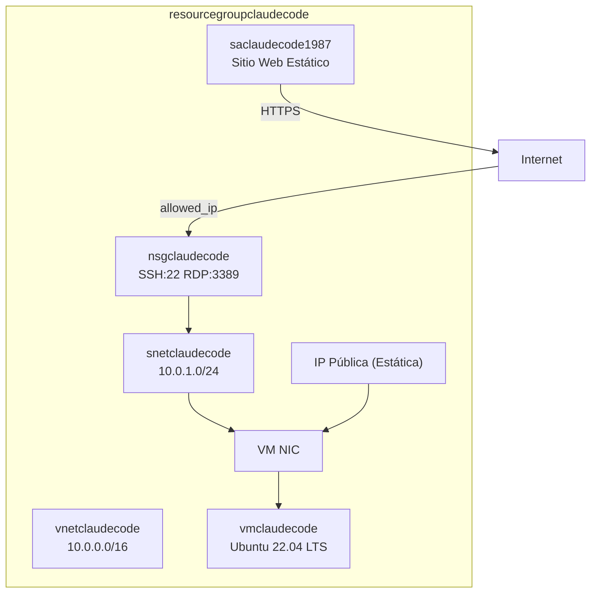
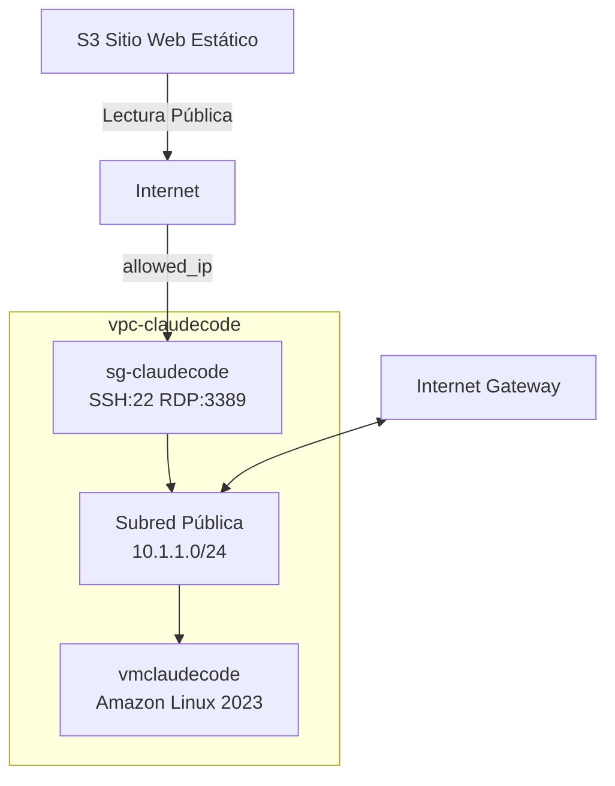

# ClaudeCodeLab — Monorepo de Infraestructura como Código

> IaC lista para producción en **Azure** (Terraform + Bicep) y **AWS** (Terraform), con CI/CD mediante GitHub Actions e integración con SonarQube.

---

## Tabla de Contenidos

1. [Vista General de la Arquitectura](#vista-general-de-la-arquitectura)
2. [Estructura del Repositorio](#estructura-del-repositorio)
3. [Recursos Creados](#recursos-creados)
   - [Azure (Terraform)](#azure-terraform)
   - [AWS (Terraform)](#aws-terraform)
   - [Azure (Bicep)](#azure-bicep)
4. [Requisitos Previos](#requisitos-previos)
5. [Despliegue](#despliegue)
   - [Azure — Terraform](#desplegar-azure--terraform)
   - [AWS — Terraform](#desplegar-aws--terraform)
   - [Azure — Bicep](#desplegar-azure--bicep)
6. [Validación](#validación)
7. [Destrucción](#destrucción)
8. [CI/CD — GitHub Actions](#cicd--github-actions)
9. [SonarQube](#sonarqube)
10. [Seguridad](#seguridad)
11. [Costos Estimados](#costos-estimados)
12. [Mejoras Futuras](#mejoras-futuras)

---

## Vista General de la Arquitectura

### Arquitectura Azure



### Arquitectura AWS



---

## Estructura del Repositorio

```
.
├── terraform/
│   ├── azure/
│   │   ├── modules/
│   │   │   ├── networking/   # VNet, Subnet, NSG
│   │   │   ├── compute/      # VM Linux, IP Pública, NIC
│   │   │   └── storage/      # Storage Account + Sitio Web Estático
│   │   ├── main.tf
│   │   ├── providers.tf      # azurerm ~> 4.0, Terraform >= 1.10
│   │   ├── variables.tf
│   │   ├── outputs.tf
│   │   ├── backend.tf        # Backend en Azure Storage
│   │   └── terraform.tfvars.example
│   └── aws/
│       ├── modules/
│       │   ├── networking/   # VPC, Subnet, IGW, RT, SG
│       │   ├── compute/      # Instancia EC2
│       │   └── storage/      # S3 Sitio Web Estático
│       ├── main.tf
│       ├── providers.tf      # aws ~> 5.0, Terraform >= 1.10
│       ├── variables.tf
│       ├── outputs.tf
│       ├── backend.tf        # Backend S3 + DynamoDB
│       └── terraform.tfvars.example
├── bicep/
│   ├── modules/
│   │   ├── networking.bicep
│   │   ├── compute.bicep
│   │   └── storage.bicep
│   ├── main.bicep
│   └── main.bicepparam
├── .github/
│   └── workflows/
│       ├── ci.yml            # fmt, validate, plan, SonarQube, subida de artefactos
│       └── destroy.yml       # destrucción manual con confirmación obligatoria
├── sonar-project.properties
├── .gitignore
└── README.md
```

---

## Recursos Creados

### Azure (Terraform)

| Recurso | Nombre | Notas |
|---------|--------|-------|
| Grupo de Recursos | `resourcegroupclaudecode` | Todos los recursos residen aquí |
| Red Virtual | `vnetclaudecode` | 10.0.0.0/16 |
| Subred | `snetclaudecode` | 10.0.1.0/24 |
| Grupo de Seguridad de Red | `nsgclaudecode` | SSH (22) + RDP (3389) |
| VM Linux | `vmclaudecode` | Ubuntu 22.04 LTS, Standard_B1s |
| IP Pública | `vmclaudecode-pip` | Estática, SKU Standard |
| Cuenta de Almacenamiento | `saclaudecode1987` | Sitio web estático habilitado |

**Etiquetas aplicadas a todos los recursos:**

| Clave | Valor |
|-------|-------|
| Environment | Dev |
| Project | ClaudeCodeLab |
| Owner | DiegoRojas |
| ManagedBy | Terraform |

### AWS (Terraform)

| Recurso | Nombre / ID | Notas |
|---------|-------------|-------|
| VPC | `vpc-claudecode` | 10.1.0.0/16 |
| Subred | `vpc-claudecode-subnet` | 10.1.1.0/24, pública |
| Internet Gateway | `vpc-claudecode-igw` | Asociado a la VPC |
| Grupo de Seguridad | `sg-claudecode` | SSH (22) + RDP (3389) desde `allowed_ip` |
| Instancia EC2 | `vmclaudecode` | Amazon Linux 2023, t3.micro |
| Bucket S3 | configurable | Sitio web estático habilitado |

**Etiquetas aplicadas a todos los recursos:**

| Clave | Valor |
|-------|-------|
| Environment | Dev |
| Project | ClaudeCodeLab |
| Owner | DiegoRojas |
| ManagedBy | Terraform |

### Azure (Bicep)

Equivalente al stack Terraform de Azure, desplegado a nivel de suscripción para crear el grupo de recursos y todos los recursos secundarios con un único comando `az deployment sub create`.

---

## Requisitos Previos

- **Terraform** >= 1.10 — [instalar](https://developer.hashicorp.com/terraform/install)
- **Azure CLI** >= 2.60 — [instalar](https://learn.microsoft.com/es-es/cli/azure/install-azure-cli)
- **AWS CLI** >= 2.15 — [instalar](https://docs.aws.amazon.com/es_es/cli/latest/userguide/getting-started-install.html)
- **Bicep CLI** (incluido en Azure CLI ≥ 2.20) — `az bicep install`
- Un Service Principal de Azure con rol **Contributor** en la suscripción destino
- Un usuario/rol IAM de AWS con permisos de **mínimo privilegio** (EC2, VPC, S3, IAM limitado)

---

## Despliegue

### Desplegar Azure — Terraform

```bash
cd terraform/azure

# 1. Copiar y editar variables
cp terraform.tfvars.example terraform.tfvars
# Editar terraform.tfvars — definir allowed_ip, vm_admin_username, vm_admin_password

# 2. Exportar credenciales de Azure
export ARM_CLIENT_ID="<client-id-del-service-principal>"
export ARM_CLIENT_SECRET="<secret-del-service-principal>"
export ARM_SUBSCRIPTION_ID="<subscription-id>"
export ARM_TENANT_ID="<tenant-id>"

# 3. Inicializar con backend remoto
terraform init \
  -backend-config="resource_group_name=rg-tfstate" \
  -backend-config="storage_account_name=satfstateclaudecode" \
  -backend-config="container_name=tfstate" \
  -backend-config="key=azure/terraform.tfstate"

# 4. Plan y Apply
terraform plan -out=azure.tfplan
terraform apply azure.tfplan
```

> ⚠️ **Reemplaza `allowed_ip`** con tu IP pública real (por ejemplo, `203.0.113.10/32`) antes de aplicar.  
> El valor por defecto `0.0.0.0/32` es un marcador de posición intencional — no coincide con ninguna dirección real.

### Desplegar AWS — Terraform

```bash
cd terraform/aws

cp terraform.tfvars.example terraform.tfvars
# Editar terraform.tfvars — definir allowed_ip, key_name, s3_bucket_name

export AWS_ACCESS_KEY_ID="<access-key>"
export AWS_SECRET_ACCESS_KEY="<secret-key>"
export AWS_DEFAULT_REGION="us-east-1"

terraform init \
  -backend-config="bucket=tfstate-claudecode-<account_id>" \
  -backend-config="key=aws/terraform.tfstate" \
  -backend-config="region=us-east-1" \
  -backend-config="dynamodb_table=tfstate-lock-claudecode"

terraform plan -out=aws.tfplan
terraform apply aws.tfplan
```

### Desplegar Azure — Bicep

```bash
cd bicep

# Editar main.bicepparam — definir adminUsername, adminPassword, allowedIp

az login
az deployment sub create \
  --location eastus \
  --template-file main.bicep \
  --parameters main.bicepparam
```

---

## Validación

```bash
# Azure Terraform
cd terraform/azure
terraform fmt -check -recursive
terraform init -backend=false
terraform validate

# AWS Terraform
cd terraform/aws
terraform fmt -check -recursive
terraform init -backend=false
terraform validate

# Bicep
az bicep build --file bicep/main.bicep

# Tras el apply — verificar el sitio web estático
curl -I $(terraform output -raw static_website_url)      # Azure
curl -I $(terraform output -raw s3_website_endpoint)     # AWS
```

---

## Destrucción

### Mediante GitHub Actions (recomendado)

1. Ir a **Actions → Destroy Infrastructure → Run workflow**
2. Seleccionar el destino (`azure` o `aws`)
3. Escribir `DESTROY` en el campo de confirmación
4. Hacer clic en **Run workflow**

### Mediante CLI

```bash
# Azure
cd terraform/azure
terraform destroy

# AWS
cd terraform/aws
terraform destroy

# Bicep (eliminar el grupo de recursos)
az group delete --name resourcegroupclaudecode --yes --no-wait
```

---

## CI/CD — GitHub Actions

### `ci.yml` — Se activa en push a `main`/`feature/**` y en Pull Requests

| Paso | Descripción |
|------|-------------|
| `terraform fmt -check` | Verifica el formato del código para Azure y AWS |
| `terraform validate` | Comprueba la sintaxis HCL y las referencias de módulos |
| `terraform plan` | Genera un plan de ejecución |
| Subida de artefacto | Guarda el `.tfplan` para auditoría (retención de 7 días) |
| SonarQube Scan | Análisis estático del código IaC |

### `destroy.yml` — Solo activación manual

Requiere seleccionar `azure` o `aws` y escribir `DESTROY` para evitar ejecuciones accidentales.

### Secretos de GitHub Requeridos

| Secreto | Usado por |
|---------|-----------|
| `ARM_CLIENT_ID` | Autenticación Azure |
| `ARM_CLIENT_SECRET` | Autenticación Azure |
| `ARM_SUBSCRIPTION_ID` | Autenticación Azure |
| `ARM_TENANT_ID` | Autenticación Azure |
| `AZURE_VM_ADMIN_USERNAME` | VM Azure |
| `AZURE_VM_ADMIN_PASSWORD` | VM Azure |
| `AZURE_TF_STATE_RG` | Backend Azure |
| `AZURE_TF_STATE_SA` | Backend Azure |
| `AWS_ACCESS_KEY_ID` | Autenticación AWS |
| `AWS_SECRET_ACCESS_KEY` | Autenticación AWS |
| `AWS_REGION` | Autenticación AWS |
| `AWS_EC2_KEY_NAME` | Par de claves EC2 |
| `AWS_TF_STATE_BUCKET` | Backend AWS |
| `AWS_TF_STATE_DYNAMODB_TABLE` | Bloqueo del backend AWS |
| `SONAR_TOKEN` | SonarQube |
| `SONAR_HOST_URL` | SonarQube |

---

## SonarQube

El archivo `sonar-project.properties` configura el escaneo de los directorios `terraform/` y `bicep/`, excluyendo la caché de `.terraform/`, los archivos de estado y los archivos `.tfvars`.

Para ejecutar localmente:

```bash
sonar-scanner \
  -Dsonar.host.url=https://tu-instancia-sonar \
  -Dsonar.token=<tu-token>
```

---

## Seguridad

- **Mínimo privilegio**: el SP de Azure y el usuario IAM de AWS tienen únicamente los permisos que requieren los recursos de este proyecto.
- **Sin secretos hardcodeados**: todos los valores sensibles se pasan mediante variables de entorno `TF_VAR_*` o GitHub Secrets.
- **Variables sensibles**: `vm_admin_username`, `vm_admin_password` (Azure) y `key_name` (AWS) están marcadas como `sensitive = true` en Terraform — se ocultan en la salida de CLI y en los archivos de plan.
- **Marcador de IP permitida**: el valor por defecto `0.0.0.0/32` para SSH/RDP no es una dirección CIDR válida — no coincide con ningún host. Reemplázalo con tu IP real antes de aplicar.
- **IMDSv2 obligatorio**: el servicio de metadatos de la instancia EC2 requiere acceso basado en token (`http_tokens = "required"`).
- **Cifrado EBS**: el volumen raíz del EC2 está cifrado en reposo.
- **Parámetros seguros en Bicep**: `adminUsername` y `adminPassword` usan el decorador `@secure()` — no se registran ni se almacenan en el historial de despliegues.
- **Cifrado del estado**: el backend de AWS usa `encrypt = true`; el backend de Azure usa cifrado del lado del servidor por defecto.

---

## Costos Estimados

> Los costos son aproximados y varían según la región. Todos los recursos están dimensionados para cargas de trabajo de **Dev/Lab**.

### Azure (por mes)

| Recurso | Tamaño | Costo Est. |
|---------|--------|------------|
| VM Linux `vmclaudecode` | Standard_B1s | ~$8 |
| IP Pública (Estática) | Standard | ~$3.50 |
| Cuenta de Almacenamiento (LRS) | — | ~$0.02/GB |
| **Total** | | **~$12/mes** |

### AWS (por mes)

| Recurso | Tamaño | Costo Est. |
|---------|--------|------------|
| EC2 `vmclaudecode` | t3.micro | ~$8.50 |
| S3 Sitio Web Estático | — | ~$0.023/GB |
| Transferencia de datos | — | variable |
| **Total** | | **~$9/mes** |

> Detén o desasigna las VMs cuando no estén en uso para reducir los costos de cómputo.

---

## Mejoras Futuras

- [ ] Reemplazar la autenticación por contraseña de la VM con **pares de claves SSH** (Azure) y **aprovisionamiento de key pair EC2** (AWS)
- [ ] Almacenar las credenciales de las VMs en **Azure Key Vault** / **AWS Secrets Manager**
- [ ] Agregar **Azure Bastion** / **AWS Systems Manager Session Manager** para eliminar la exposición pública de SSH/RDP
- [ ] Habilitar **Microsoft Defender for Cloud** en la suscripción de Azure
- [ ] Habilitar **AWS Security Hub** y **GuardDuty**
- [ ] Agregar los pasos de **`tfsec`** y **`checkov`** de Terraform al CI para escaneo de seguridad en IaC
- [ ] Usar **federación OIDC** en GitHub Actions (reemplazar el service principal de larga duración y las claves IAM)
- [ ] Agregar documentación automática de módulos con `terraform-docs`
- [ ] Parametrizar el número de VMs / agregar grupo de auto-escalado en AWS
- [ ] Agregar monitoreo: alertas de **Azure Monitor** y alarmas de **AWS CloudWatch** para CPU y disco de las VMs
